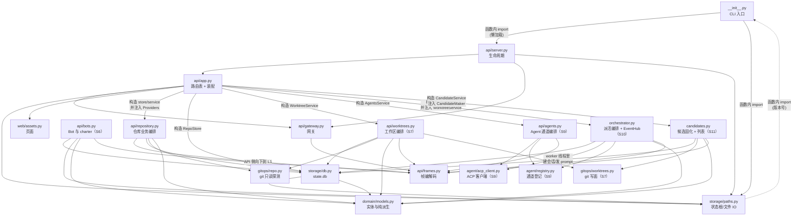

# 02 · 分层与依赖规则

> 上游：[README.md](README.md) · 相关：[01-overview](01-overview.md) · [06-pitfalls](06-pitfalls.md)

---

## 1. 五层，自下而上

```
  ┌─────────────────────────────────────────────┐
  │ L4  web/assets.py     页面 + 内联 JS          │  唯一允许「面向用户」的字符串
  ├─────────────────────────────────────────────┤
  │ L3  api/gateway.py    协议与认证              │
  │     api/app.py        路由表 + 装配           │
  │     api/repository.py 仓库业务编排（S3）      │  不碰 fastapi
  │     api/bots.py       Bot 与 charter 编排（S6）│  不碰 fastapi
  │     api/worktrees.py  工作区编排（S7）        │  不碰 fastapi
  │     api/agents.py     Agent 通道编排（S9）    │  不碰 fastapi
  │     orchestrator.py   派活编排 + EventHub（S10）│  不碰 fastapi、不 import 同层 handler
  ├─────────────────────────────────────────────┤
  │ L2  api/server.py     进程生命周期            │  唯一拥有 socket / 信号
  ├─────────────────────────────────────────────┤
  │ L1  api/frames.py     纯数据变换              │  无 IO、无 async、无框架
  ├─────────────────────────────────────────────┤
  │ L0  gitops/repo.py    git 只读探测（S3）      │  
  │     gitops/worktrees.py git 写面（S7 三条 + S11 三条）│  唯一改 .git/worktrees 的地方
  │     agent/acp_client.py ACP 客户端（S9）      │  起 Agent 子进程（第二条子进程线）
  │     agent/registry.py   通道登记（S9）        │  
  │     storage/db.py     state.db（S3）          │  唯一碰 SQLite 的地方
  │     storage/paths.py  文件系统                │  状态根/锁/原子写
  │     domain/models.py  实体与纯派生（S3）      │  无 IO
  │     __init__.py       CLI 入口                │
  └─────────────────────────────────────────────┘
```

**S3 新增三块**：`gitops/`（子进程）、`storage/db.py`（SQLite）、`domain/`（纯模型），
以及 L3 的 `api/repository.py`（业务编排）。它们都是**新层，遵守同一张表**。
**S6 只加了同层的一个新模块**：`api/bots.py`（L3，与 repository 同款：不碰 fastapi）。
**S7 加了两个**：`api/worktrees.py`（L3，同款）与 `gitops/worktrees.py`（L0，**写面**——S7 起
内核第一次改用户的仓库，允许清单见 [S7 D5](../design/issues/S7-worktree-visible.md)）。
S7 还顺手把两条**共享判定**下沉了一层：`ref_name_ok`（→ `domain`）与 `is_usable_repo`（→ `gitops`），
就是为了不让 L3 之间互相 import（见 §3）。
**S9 加了三个**：`agent/acp_client.py` 与 `agent/registry.py`（L0，**第二条子进程线**——与 git 的
只读探测分开登记；`05 §3.3` 的「字面数组、无 shell、不展开 `~`/`$VAR`」同样适用于它），以及
`api/agents.py`（L3，同款 handler）。`agent/` 这一层在 §5 的表里早就预告过，S9 只是把它兑现。
**S10 加了一个**：`orchestrator.py`（L3，同款纪律）。它 Down-import `agent/` / `storage/` /
`domain/` / `frames`，但**不 import 任何同层 handler**（D13）：需要 `WorktreeService` 时由
`app` 装配注入（`WorktreeAcquirer` Protocol），环靠构造消掉——与 §3 的注入纪律同一条路，
只是这次连「同层」都没有例外。

**规则一句话：只能向下 import，不能向上；同层之间尽量不 import（唯一例外见 §3）。**

## 2. 当前真实的 import 边



| 边 | 为什么存在 | 能不能删 |
|---|---|---|
| `CLI → server`（函数内） | 让 `--help` / `version` 不必加载 fastapi/uvicorn | **别删**：删了 `version` 子命令会变慢并引入可选依赖 |
| `CLI → paths`（函数内） | 捕获 `KernelBootError` | 同上 |
| `server → app` | 起 uvicorn 要 app | 否 |
| `server → gateway` | 要 `GATEWAY_PATH` 常量 | 否 |
| `server → paths` | 所有文件操作 | 否 |
| `app → gateway` | 挂载网关 | 否 |
| `app → paths` | `state_root()` 渲染页面 | 否 |
| `app → assets` | 渲染页面 | 否 |
| `gateway → frames` | 帧编解码 | 否 |
| `paths → __version__`（函数内） | 锁文件要写版本号 | **别删**：版本号只允许一个事实源（包根） |
| `app → repository`（S3） | 构造 `RepositoryService` 注入网关 | 否 |
| `app → db`（S3） | 构造 `RepoStore`（`state.db` 在状态根） | 否 |
| `repository → db`（S3） | 落库 | 否 |
| `repository → gitops`（S3） | 探测仓库 | 否 |
| `repository → domain`（S3） | `Repo` 与 `repo_id` | 否 |
| `repository → frames`（S3） | 抛 `FrameError`（纯数据错误类型） | 否 |
| `db → paths`（S3） | 取 `state.db` 路径（唯一事实源） | 否 |
| `db → domain`（S3） | 行 ↔ `Repo` / `Bot` | 否 |
| `app → bots`（S6） | 构造 `BotStore` + `BotService` 注入网关 | 否 |
| `bots → db`（S6） | `BotStore` 读写 `bots` 表 | 否 |
| `bots → paths`（S6） | 记忆空间（`ensure_memory_space` / `read_charter`）、`memoryPath` | 否 |
| `bots → domain`（S6） | `Bot` / `bot_id` / 权限默认值 | 否 |
| `bots → frames`（S6） | 抛 `FrameError`（与 repository 同款） | 否 |
| `app → worktrees`（S7） | 构造 `WorktreeService` 注入网关 | 否 |
| `worktrees → db`（S7） | 两个 store：`repoId` 存不存在、`botId` 属不属于这个仓库 | 否 |
| `worktrees → gitops`（S7） | `is_usable_repo`（T25）+ 写面 `add/remove/prune` | 否 |
| `worktrees → domain`（S7） | `bot_id` / `bot_name_ok` / `ref_name_ok` | 否 |
| `worktrees → frames`（S7） | 抛 `FrameError` | 否 |
| `gitops/worktrees → gitops/repo`（S7） | 复用 `git_env` / `git_executable` / 三个异常（**环境只许一份**） | 否 |
| `app → agents`（S9） | 构造 `AgentsService` 注入网关 | 否 |
| `agents → agent/acp_client`（S9） | 起进程、握手、回收 | 否 |
| `agents → agent/registry`（S9） | 读通道表与命令 | 否 |
| `agents → frames`（S9） | 抛 `FrameError`（与 repository / bots / worktrees 同款） | 否 |
| `app → orchestrator`（S10） | 构造 `Orchestrator`（TaskStore/LeaseStore/EventHub + `WorktreeService` 注入） | 否 |
| `orchestrator → db`（S10） | `TaskStore` / `LeaseStore` / `BotStore` 读写 | 否 |
| `orchestrator → agent/acp_client`（S10） | worker 线程里建会话、发 prompt、取消、回收 | 否 |
| `orchestrator → agent/registry`（S10） | `_channel_for`：`bot.agentKind` 优先，缺省第一条通道 | 否 |
| `orchestrator → domain`（S10） | `Task` / `WorktreeLease` / `ulid` / `prompt_ok` / 状态机 / `permission_covers` | 否 |
| `orchestrator → frames`（S10） | 抛 `FrameError`（同款） | 否 |
| **`orchestrator → worktrees`** | **不存在，也不许有**（D13）：只持有 `WorktreeAcquirer` Protocol，实例由 `app` 注入 | — |
| **`gateway → repository`** | **不存在，也不许有**：网关只收到 `Providers` 里的两个函数 | — |

### 2.0 S3 的分层要点：`repository` 在 L3，但它不认识 fastapi

`api/repository.py` 与 `gateway` / `app` 同层（L3），但**只向下**依赖 `frames` / `db` /
`gitops` / `domain`，**不 import fastapi**。它连"帧"也只用 `frames.FrameError` 这个纯数据类型。
方向是：`app → repository`（装配），`gateway → Providers → repository.bind`（注入的函数）。
**`gateway` 不 import `repository`**，与 S2 那条 `gateway ∦ app` 是同一套理由。

### 2.1 两处「函数内 import」的理由**不同**，不要混为一谈

这是最容易搞错的地方，S2 审核时踩过一次：

| 位置 | 理由 | 是否伪善 |
|---|---|---|
| `__init__.py:33` | **懒加载**：CLI 的 `version`/`--help` 不想拖起 fastapi | 正当 |
| `paths.py:164` | **避免重复定义版本号**：`__version__` 只在包根定义一次；模块级 import 会成环（包根 → server → app → ... → paths） | 正当 |
| ~~`gateway.py:88`~~ | ~~「避免 import 环」~~ S2 初版。**环是真的，但不该绕开**：用 `Providers` 注入消除 | **已修**（R3） |

**判断标准**：函数内 import 只有在「为了性能/懒加载」或「为了单一事实源」时才正当。
**为了绕开循环依赖不正当**——循环依赖说明分层错了，应该改结构（S2 就是这么修的）。

## 3. 同层 import 的唯一例外

`api/app.py` 与 `api/gateway.py` 是同层，但 `app` 必须 import `gateway`（挂载网关）。
为了不让反向也成立（那会成环），**`gateway` 不 import `app`**，而是由 `app` 把 `health`
作为 `Providers` 注入：

```python
# app.py:78
gateway.install(app, ws_path, tickets, gateway.Providers(health=health))
```

**新代码若要跨同层调用，用同样的注入方式，不要反向 import。**

## 4. 可执行检查

规则不落成检查就会腐烂——**S4.5 起它不再是文档片段，已经进门禁**：`scripts/gate-layers.py`
（`bash scripts/check.sh layers`，CI 也跑）把下表编码成机器可查的规则。

| 模块 | 不许 import |
|---|---|
| `storage/paths.py`、`storage/db.py` | `api` / `web` / `gitops` |
| `domain/models.py` | `api` / `web` / `gitops` / `storage` |
| `gitops/repo.py` | `api` / `web` / `storage` / `domain` |
| `agent/acp_client.py`、`agent/registry.py`（S9，L0） | `api` / `web` / `storage` / `domain` / `gitops` |
| `api/frames.py`（L1，纯数据变换） | 上面全部 + `fastapi` / `starlette` / `uvicorn` / `websockets` / `subprocess` / `sqlite3` |
| `api/server.py`（L2） | `repository` / `web` / `storage.db` |
| `api/app.py` | `api/server.py`（反向会成环） |
| `api/gateway.py` | `api/app.py`（T14：能力靠 `Providers` 注入）/ `api/server.py` / `repository` / `web` / `storage` / `gitops` / `domain` |
| `api/repository.py` | `app` / `gateway` / `server` / `web` / `fastapi` / `starlette` / `uvicorn` |
| `api/bots.py`（S6，L3） | `web`（被 app 装配、被 gateway 注入调用；碰页面就是反向） |
| `api/agents.py`（S9，L3） | `web` + 同层其它 handler（`app` / `gateway` / `server` / `repository` / `bots` / `worktrees`） |
| `candidates.py`（S11，L3） | `web` + 同层**全部** handler（含 `orchestrator`）——`CandidateMaker` Protocol 注入（D13） |
| `orchestrator.py`（S10，L3） | `web` + 同层**全部** handler（`app` / `gateway` / `server` / `repository` / `bots` / `worktrees` / `agents`）——`WorktreeService` 靠 `WorktreeAcquirer` Protocol 注入（D13） |
| `web/assets.py`（L4） | `api`（被 app import，反向即环） |

两条比旧片段更严的地方：

1. **`import x` 与 `from x import y` 都查**，且 `from postel_studio.api import app` 会展开成
   `postel_studio.api.app` 再比对——只比对 `node.module` 会漏掉这条最常见的越界写法。
2. **新模块必须登记层**：`src/postel_studio/` 下新增任何 `.py` 而没在
   `scripts/gate-layers.py` 的 `LAYERS` 里登记，门禁直接失败（不登记 = 没有规则）。

**注意**：`paths → __version__` 那条是**故意允许**的（`__version__` 是包级常量而不是一层），
所以不在任何 forbiddin 列表里。

文档里的旧片段已退役（留着会被误当成"已经在跑"）。改层规则时改脚本，别改这里。

## 5. 未来会新增的层（S3+）

按 `docs/design/02-architecture.md` §2，后续会出现这些 Service。**它们各自成层，
且必须遵守「只能向下」**：

| 未来模块 | 归属层 | 会被谁调用 |
|---|---|---|
| ~~`git/`~~ → **已出现**：`gitops/`（S3） | L0（碰磁盘/子进程） | `api/repository.py` |
| ~~`store/`~~ → **已出现**：`storage/db.py`（S3，**有意不叫 `store/`**：`RepoStore` 是类名，包名会让"store 模块"和"store 对象"混淆） | L0 | `api/app.py`、`api/repository.py` |
| ~~后续 bot 表~~ → **已出现**（S6）：`bots` | `storage/db.py` 的 `_MIGRATIONS` v3 | `api/bots.py` |
| ~~后续 task/candidate 表~~ → **已出现**：`tasks` + `worktree_leases`（S10 v4）、`candidates`（S11 v5） | 加到 `storage/db.py` 的 `_MIGRATIONS` | `orchestrator.py` / `candidates.py` |
| ~~`agent/`（ACP 客户端、子进程）~~ → **已出现（S9）**：`agent/acp_client.py`（协议）+ `agent/registry.py`（通道表） | L0 | `api/agents.py` |
| `permission/`（纯函数判定） | L1（**无 IO**） | 执行前 |
| ~~`memory/`（charter 与上下文注入）~~ → **S6 拆成两处**：charter 文件 IO 在 `storage/paths.py`（L0）、编排在 `api/bots.py`（L3） | 不新增包 | `storage/paths.py`、`api/bots.py` |
| 新的 `api/*.py` handler 模块 | L3 | app/gateway |

**关键约束（来自 05-security）**：`permission/` 必须是**纯函数、无 IO**，且判定发生在执行之前。
这意味着它**不能** import `agent/` 或 `git/`。若将来它需要读 Bot 权限，权限数据应作为参数传入。

## 6. 禁止事项

- **禁止** `web/` import 任何 `api/` 代码——页面只拿字符串，不知道后端结构。
- **禁止** `api/frames.py` import 任何框架（fastapi/starlette/uvicorn）。它是纯函数模块，
  这条保证了帧编解码的单元测试不需要起服务。
- **禁止** 让 `storage/paths.py` 判断进程存活或处理信号（那是 `api/server.py` 的职责）。
  这条是为了让 paths 的所有函数都能被安全地单元测试。
- **禁止**在 `gateway.dispatch()` 里写 `if agent == "opencode"` 这类具体 Agent 分支
  （04-task-breakdown §6 全局禁令）。
- **禁止** `api/repository.py` import fastapi / starlette / uvicorn（S3 涉及文件表的要求）。
- **禁止** `api/bots.py` import `web`（S6 的 `LAYERS` 登记只有这一条禁令）：页面由 `app` 渲染，
  业务编排不产出任何面向用户的 HTML。
- **禁止** `domain/` 碰 IO（不 `open`、不 `subprocess`、不 `sqlite3`）：它无依赖才能被一行断言。
- **禁止** 在 `gitops/` 之外再写 `subprocess.run([... "git" ...])`：允许根（D4）只有一处实现。