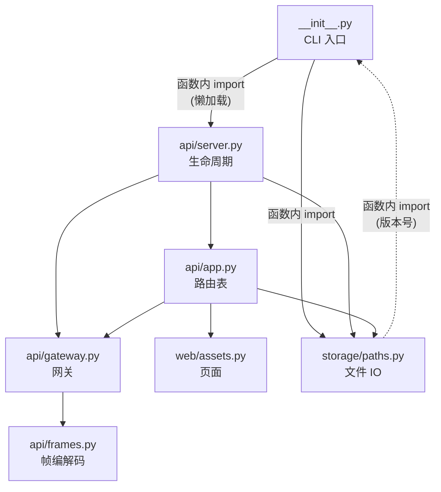

# 02 · 分层与依赖规则

> 上游：[README.md](README.md) · 相关：[01-overview](01-overview.md) · [06-pitfalls](06-pitfalls.md)

---

## 1. 五层，自下而上

```
  ┌─────────────────────────────────────────────┐
  │ L4  web/assets.py     页面 + 内联 JS          │  唯一允许「面向用户」的字符串
  ├─────────────────────────────────────────────┤
  │ L3  api/gateway.py    协议与认证              │
  │     api/app.py        路由表                  │
  ├─────────────────────────────────────────────┤
  │ L2  api/server.py     进程生命周期            │  唯一拥有 socket / 信号
  ├─────────────────────────────────────────────┤
  │ L1  api/frames.py     纯数据变换              │  无 IO、无 async、无框架
  ├─────────────────────────────────────────────┤
  │ L0  storage/paths.py  文件系统                │  唯一碰磁盘的地方
  │     __init__.py       CLI 入口                │
  └─────────────────────────────────────────────┘
```

**规则一句话：只能向下 import，不能向上；同层之间尽量不 import（唯一例外见 §3）。**

## 2. 当前真实的 import 边



| 边 | 为什么存在 | 能不能删 |
|---|---|---|
| `CLI → server`（函数内） | 让 `--help` / `version` 不必加载 fastapi/uvicorn | **别删**：删了 `version` 子命令会变慢并引入可选依赖 |
| `CLI → paths`（函数内） | 捕获 `KernelBootError` | 同上 |
| `server → app` | 起 uvicorn 要 app | 否 |
| `server → gateway` | 要 `GATEWAY_PATH` 常量 | 否 |
| `server → paths` | 所有文件操作 | 否 |
| `app → gateway` | 挂载网关 | 否 |
| `app → paths` | `state_root()` 渲染页面 | 否 |
| `app → assets` | 渲染页面 | 否 |
| `gateway → frames` | 帧编解码 | 否 |
| `paths → __version__`（函数内） | 锁文件要写版本号 | **别删**：版本号只允许一个事实源（包根） |

### 2.1 两处「函数内 import」的理由**不同**，不要混为一谈

这是最容易搞错的地方，S2 审核时踩过一次：

| 位置 | 理由 | 是否伪善 |
|---|---|---|
| `__init__.py:33` | **懒加载**：CLI 的 `version`/`--help` 不想拖起 fastapi | 正当 |
| `paths.py:164` | **避免重复定义版本号**：`__version__` 只在包根定义一次；模块级 import 会成环（包根 → server → app → ... → paths） | 正当 |
| ~~`gateway.py:88`~~ | ~~「避免 import 环」~~ S2 初版。**环是真的，但不该绕开**：用 `Providers` 注入消除 | **已修**（R3） |

**判断标准**：函数内 import 只有在「为了性能/懒加载」或「为了单一事实源」时才正当。
**为了绕开循环依赖不正当**——循环依赖说明分层错了，应该改结构（S2 就是这么修的）。

## 3. 同层 import 的唯一例外

`api/app.py` 与 `api/gateway.py` 是同层，但 `app` 必须 import `gateway`（挂载网关）。
为了不让反向也成立（那会成环），**`gateway` 不 import `app`**，而是由 `app` 把 `health`
作为 `Providers` 注入：

```python
# app.py:78
gateway.install(app, ws_path, tickets, gateway.Providers(health=health))
```

**新代码若要跨同层调用，用同样的注入方式，不要反向 import。**

## 4. 可执行检查

规则不落成检查就会腐烂。下面的代码片段用于人工或 CI 复核**向上依赖**：

```bash
# 检查是否出现「向上 import」（L0/L1 不应 import L2+）
uv run python - <<'PY'
import ast, pathlib, sys
UP = {
    "storage/paths.py": ("api/", "web/"),
    "api/frames.py":    ("app", "gateway", "server", "web/"),
    "api/server.py":    ("web/",),
}
bad = []
for rel, forbidden in UP.items():
    path = pathlib.Path("src/postel_studio") / rel
    for node in ast.walk(ast.parse(path.read_text(encoding="utf-8"))):
        if isinstance(node, ast.ImportFrom) and node.module:
            for f in forbidden:
                if f in node.module or any(f in (a.name or "") for a in node.names):
                    bad.append(f"{rel}:{node.lineno} → {node.module}")
for b in bad: print("违例:", b)
sys.exit(1 if bad else 0)
PY
```

**注意**：上面只查了「明显向上」的边。`paths → __version__` 那条是**故意允许**的
（因为 `__version__` 是包级常量而不是一层），所以不在 forbiddin 列表里。

> 这份检查目前是**文档里的片段**，没有进 `scripts/check.sh`。若层数继续变多，应把它固化进
> 门禁（届时需要新增 `scripts/check_layers.py`）。

## 5. 未来会新增的层（S3+）

按 `docs/design/02-architecture.md` §2，后续会出现这些 Service。**它们各自成层，
且必须遵守「只能向下」**：

| 未来模块 | 归属层 | 会被谁调用 |
|---|---|---|
| `git/`（仓库、分支、diff、worktree） | L0（碰磁盘/子进程） | gateway 的 handler |
| `store/`（SQLite：bot、task、candidate） | L0 | |
| `agent/`（ACP 客户端、子进程） | L0 | |
| `permission/`（纯函数判定） | L1（**无 IO**） | 执行前 |
| `memory/`（charter 与上下文注入） | L0 | |
| 新的 `api/*.py` handler 模块 | L3 | app/gateway |

**关键约束（来自 05-security）**：`permission/` 必须是**纯函数、无 IO**，且判定发生在执行之前。
这意味着它**不能** import `agent/` 或 `git/`。若将来它需要读 Bot 权限，权限数据应作为参数传入。

## 6. 禁止事项

- **禁止** `web/` import 任何 `api/` 代码——页面只拿字符串，不知道后端结构。
- **禁止** `api/frames.py` import 任何框架（fastapi/starlette/uvicorn）。它是纯函数模块，
  这条保证了帧编解码的单元测试不需要起服务。
- **禁止** 让 `storage/paths.py` 判断进程存活或处理信号（那是 `api/server.py` 的职责）。
  这条是为了让 paths 的所有函数都能被安全地单元测试。
- **禁止**在 `gateway.dispatch()` 里写 `if agent == "opencode"` 这类具体 Agent 分支
  （04-task-breakdown §6 全局禁令）。