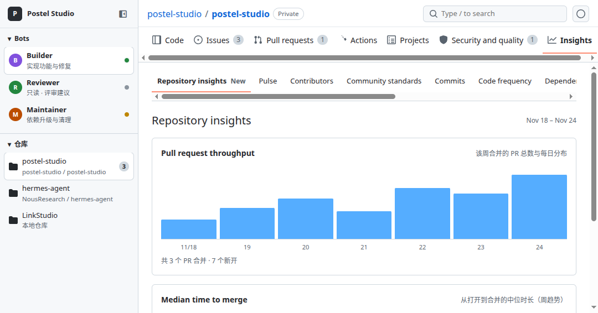
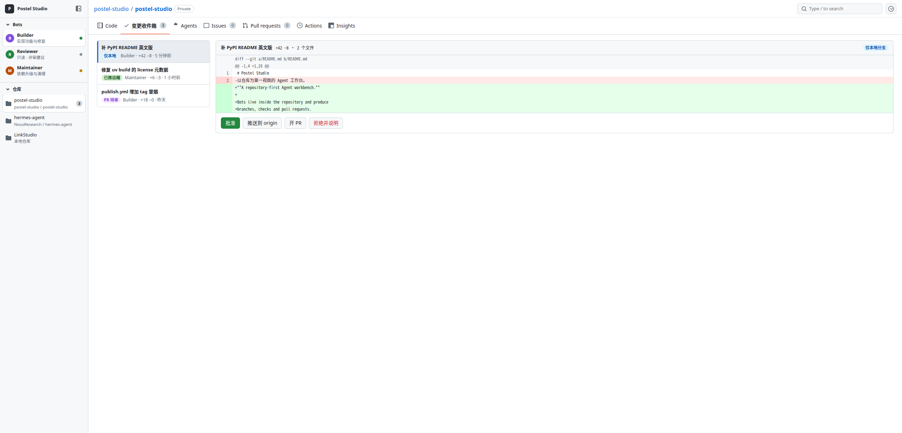

# 03 · UI 规格

> 状态：讨论定稿 v1 · 2026-11-26
> 原型：[prototype/postel-studio-proto-v2.html](prototype/postel-studio-proto-v2.html)
> 截图：`shots/v2/`
> 上游：[01-requirements.md](01-requirements.md)

---

## 1. 设计基线

**仓库页尽量全仿 GitHub。** 参照对象是真实页面（`NousResearch/hermes-agent`），不是凭印象：

- 一级 tab 取 7 个：`Code / Issues / Pull requests / Actions / Projects / Security and quality / Insights`，**不含 Agents**。
- 文件表三列：`Name · Last commit message · Last commit date`。
- README 渲染在文件表**下方**，右侧是 About 侧栏（描述 / Topics / Releases / Packages / Contributors / Languages 进度条）。
- Insights 含 11 个子页：Repository insights / Pulse / Contributors / Community standards / Commits / Code frequency / Dependency graph / Network / Forks / Actions usage metrics / Actions performance metrics。

配色取自 Primer 语义 token 的重建（浅色 + 暗色两套），不硬编码单一主题）。

### 效果预览

Code 页（v2）——文件表三列、README 在下方、右侧 About 含 Languages 进度条：


Issues 页（v2）——左侧筛选栏、Open/Active/Closed 计数条、issue 列表：


Insights（v2）——11 个子页，含真实空态：



变更收件箱（v1）——产品的第一视图。**v2 中暂无入口**，入口位置见 §6 Q1：



> 更多截图见 [`shots/`](shots/)，原型文件见 [`prototype/README.md`](prototype/README.md)。

## 2. 布局骨架

```
┌──────────────┬────────────────────────────────────┐
│ 左栏 248px   │ 主区                                │
│              │ ┌──────────────────────────────────┐│
│ ▾ Bots       │ │ 面包屑 owner/repo  搜索  主题     ││
│   Builder ●  │ ├──────────────────────────────────┤│
│   Reviewer   │ │ 一级 tab（仿 GitHub）             ││
│   Maintainer │ ├──────────────────────────────────┤│
│ ───────────  │ │ 页面内容                          ││
│ ▾ 仓库        │ │                                  ││
│   postel-…③  │ │                                  ││
└──────────────┴────────────────────────────────────┘
```

- 左栏**上 Bot / 下 仓库**，取代传统 Agent 的 session 列表。
- Bot 与仓库两个分区**各自**可折叠；整个左栏可收成 60px 图标条。
- 每行 Bot 显示状态点：`idle`（灰）/ `run`（绿）/ `wait`（黄＝等待审批）。

## 3. 仿制区 vs 产品区（必须区分）

| 区域 | 来源 | 规则 |
|---|---|---|
| Code / Issues / Pull requests / Actions / Projects / Security / Insights | 仿 GitHub | **尽量完全一致**：列名、按钮文案、空态文案保留 |
| 变更收件箱 | **产品独有** | 不能被误解为 GitHub 的 Pull requests |
| Bot 配置（身份 / 权限 / charter / 记忆 / 工作日志） | 产品独有 | 入口待定（见 §6 Q1） |

**空态必须保留真实文案**，例如 `No projects found`、`Code frequency` 的「无法生成此图」——空态若做成空白，会被误认为页面坏了。

## 4. 关键界面规格

### 4.1 Code 页

| 元素 | 规格 |
|---|---|
| 分支条 | `main ▾` 分段按钮 + 分支计数 + `Go to file` + `Add file ▾` + 最近提交（头像 + 摘要 + sha + 相对时间） |
| 文件表 | 三列；文件夹用填充图标、文件用轮廓图标；提交摘要截断省略 |
| README | 渲染在文件表下方，标题带下边框 |
| 右侧 About | 宽 296px；Languages 用堆叠进度条 + 百分比列表 |

### 4.2 变更收件箱（产品区）

- 左列候选列表：标题 / 状态标签（仅本地 · 已推远端 · PR 待审）/ Bot 名 / `+/−` 统计 / 相对时间。
- 右列 diff：行号栏 + 增删底色（用 `--add-bg` / `--del-bg`）。
- 操作按钮顺序固定：**批准 → 推送到 origin → 开 PR → 拒绝并说明**。
- **不提供「合并」按钮**（L4 永不开放给 Bot）。

### 4.3 Bot 配置（产品区）

四张卡：身份与边界（权限徽章、适配器、记忆路径）/ 宪法层 charter / 规范层来源（AGENTS.md 是否注入、冲突规则）/ 工作日志（当前任务、工作区、产出分支）。

### 4.4 差异面板（产品区 · S5）

主区在「分支」面板**之后**新增一节 `#diff`（不重排既有布局）。它回答一个动作：
**点某个分支 → 看到它与默认分支的差异**；也支持手填两个 ref 对比。

**状态机**（`#diff[data-state]`，显隐只由 CSS 决定，JS 只改属性）：

| 状态 | 何时 | 用户看到 |
|---|---|---|
| `idle` | 未选仓库 / 选了还没点分支 / 点的是默认分支 / 游离 HEAD / 已断开 | 提示文案（初始：「点左侧分支查看它与默认分支的差异，或在上方填两个 ref」；默认分支：「这是默认分支，选择其它分支查看差异」；断连：「已断开：差异未知」） |
| `loading` | 已发 `repo.diff` 等回包 | 「正在读取差异…」 |
| `ready` | 成功（含空差异） | 统计串 +（非空时）着色 patch；截断时另有一行「已截断：差异太大，只显示前一部分」 |
| `error` | 失败（`BAD_REF` / `REPO_NOT_BOUND` / …） | 按**码**映射的中文错误，不是 500、不是空白 |

**着色规则**（只按行着色，不做语法高亮）：

| 行前缀（按此顺序判） | 颜色 |
|---|---|
| `diff --git ` / `index ` / `new file mode ` / `deleted file mode ` / `old mode ` / `new mode ` / `\` | 灰（文件头/元信息） |
| `@@` | 蓝（hunk 头） |
| `+++ ` / `--- ` | 灰（**文件头，不能算 add/del**） |
| `+` | 绿（新增） |
| `-` | 红（删除） |
| 其它 | 继承正文色（上下文） |

**截断提示**：内容超过 `maxChars`（缺省 100k，区间 1000–200k）时 `truncated: true`，
面板显示固定文案「已截断：差异太大，只显示前一部分」，**不静默丢**；统计数字仍描述完整差异。

**其他交互约束**：

- 分支行键盘可达（`Tab` 聚焦，`Enter`/`Space` 触发），与左栏仓库行一致；
- 切仓库 / 断连：面板回 `idle` 并清空（不留旧 diff 装新鲜）；**重连不自动重发 diff**；
- patch 是**不可信文本**（文件名可以是 `<script>`）：一律 `textContent`，全页零 `innerHTML`；
- 不设固定宽度、不假设中文宽度（等宽字体 + 自动换行 + 自身滚动）。

## 5. 交互约束

- 主题切换：浅/暗两套 token，**必须**同时校验两套下的对比度。
- 左栏折叠：`grid-template-columns` 过渡 200ms。
- 面板切换为本地状态，零往返。
- 数据来源一律走 [02b-protocol.md](02b-protocol.md) 的帧，**不在前端直接读 git**。

## 6. 待定（阻塞 UI 实现）

| # | 问题 | 选项 | 影响 |
|---|---|---|---|
| Q1 | 变更收件箱入口 | ① 一级 tab ② 左栏仓库条目下 ③ Code 页侧栏卡片 | 决定信息架构 |
| Q2 | 智能角色叫 Bot 还是 Agents | — | 决定左栏与文案；与 GitHub Agents tab 的区分 |
| Q3 | 「派活给 Bot」入口位置 | ① 主区右上 ② 每个 Bot 行上 | 决定主要操作路径 |

## 7 验收口径

- 7 个一级 tab 名称与参照页**逐字一致**。
- Insights 11 个子页均可切换且各有内容（含真实的空态文案）。
- 浅/暗切换后无不可读文本。
- 变更收件箱的**任一操作**都能明确映射到一条协议方法名。

> 原型是讨论产物，**不是**可交付实现；实现以 Issue 验收标准为准。