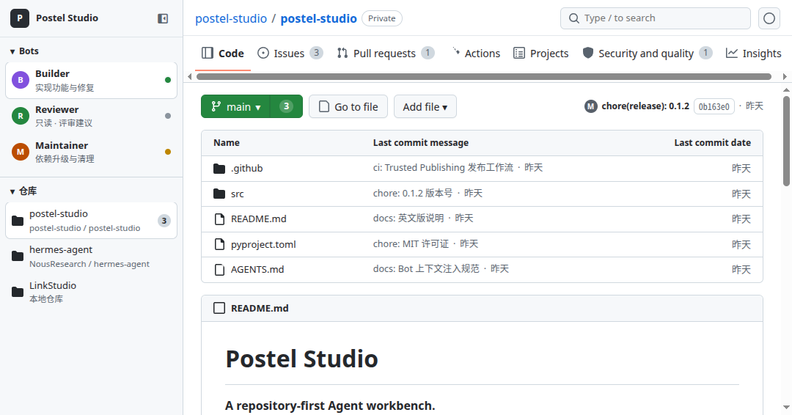
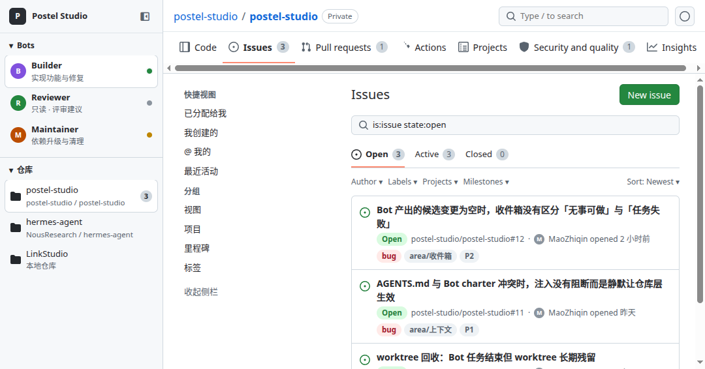

# 03 · UI 规格

> 状态：讨论定稿 v1 · 2026-11-26
> 原型：[prototype/postel-studio-proto-v2.html](prototype/postel-studio-proto-v2.html)
> 截图：`shots/v2/`
> 上游：[01-requirements.md](01-requirements.md)

---

## 1. 设计基线

**仓库页尽量全仿 GitHub。** 参照对象是真实页面（`NousResearch/hermes-agent`），不是凭印象：

- 一级 tab 取 7 个：`Code / Issues / Pull requests / Actions / Projects / Security and quality / Insights`，**不含 Agents**。
- 文件表三列：`Name · Last commit message · Last commit date`。
- README 渲染在文件表**下方**，右侧是 About 侧栏（描述 / Topics / Releases / Packages / Contributors / Languages 进度条）。
- Insights 含 11 个子页：Repository insights / Pulse / Contributors / Community standards / Commits / Code frequency / Dependency graph / Network / Forks / Actions usage metrics / Actions performance metrics。

配色取自 Primer 语义 token 的重建（浅色 + 暗色两套），不硬编码单一主题）。

### 效果预览

Code 页（v2）——文件表三列、README 在下方、右侧 About 含 Languages 进度条：



Issues 页（v2）——左侧筛选栏、Open/Active/Closed 计数条、issue 列表：



Insights（v2）——11 个子页，含真实空态：


变更收件箱（v1）——产品的第一视图。**v2 中无一级 tab 入口**；S12 起入口在左栏仓库条目下（§6 Q1 已裁决）：


> 更多截图见 [`shots/`](shots/)，原型文件见 [`prototype/README.md`](prototype/README.md)。

## 2. 布局骨架

```
┌──────────────┬────────────────────────────────────┐
│ 左栏 248px   │ 主区                                │
│              │ ┌──────────────────────────────────┐│
│ ▾ Bots       │ │ 面包屑 owner/repo  搜索  主题     ││
│   Builder ●  │ ├──────────────────────────────────┤│
│   Reviewer   │ │ 一级 tab（仿 GitHub）             ││
│   Maintainer │ ├──────────────────────────────────┤│
│ ───────────  │ │ 页面内容                          ││
│ ▾ 仓库        │ │                                  ││
│   postel-…③  │ │                                  ││
└──────────────┴────────────────────────────────────┘
```

- 左栏**上 Bot / 下 仓库**，取代传统 Agent 的 session 列表。
- Bot 与仓库两个分区**各自**可折叠；整个左栏可收成 60px 图标条。
- 每行 Bot 显示状态点：`idle`（灰）/ `run`（绿）/ `wait`（黄＝等待审批）。
- **S6 起「Bots」区落地**：选中仓库后列出该仓库的 Bot；每行显示 名字 / 权限徽标 / charter
  摘要（第一个正文段落；空 charter 显示「尚未填写职责」）。点行（鼠标或 `Enter`）→ 主区看到
  charter 全文与记忆目录。**S8 起有创建入口**（见下），**仍然没有**运行状态点（S10 起）。
- **S7 起主区出现「工作区」卡片**（在 Charter 面板之后）：一个基础分支输入框（预填该仓库的
  默认分支）+「分配工作区」按钮；分配后显示 **路径 / 分支 / Bot**，并出现「回收工作区」。
  卡片始终写明它作用在哪个 Bot 上（M1 只有一个，S8 起才需要选）。三条 UI 纪律：
  分配是**显式动作**（选仓库只读 `worktree.list`，绝不自动建目录）；空态（"还没有分配工作区"）
  与错误态必须区分；回收被拒（脏工作区）时**路径与按钮留在原地**，让人处理完能再点一次。
- **S8 起 Bots 区有「新建 Bot」**：按钮只在 `#bots` 是 `ready` 时出现（没选仓库/读取中/出错时
  不装作能建）；点开是一个表单——名字输入 + **权限下拉**（`L0` / `L1`（默认）/ `L2` / `L2+`，
  **没有** `L3`/`L4`，连灰掉也不放）+ 创建 / 取消。创建成功后表单收起、左栏立刻多一行；
  失败时表单留着、光标回到名字框，错误行说出**规则**而不是复述输入。Escape 收起表单（焦点
  回到「新建 Bot」）。空态「这个仓库还没有 Bot。」与按钮同时出现——空不是错误。

## 3. 仿制区 vs 产品区（必须区分）

| 区域 | 来源 | 规则 |
|---|---|---|
| Code / Issues / Pull requests / Actions / Projects / Security / Insights | 仿 GitHub | **尽量完全一致**：列名、按钮文案、空态文案保留 |
| 变更收件箱 | **产品独有** | 不能被误解为 GitHub 的 Pull requests |
| Bot 配置（身份 / 权限 / charter / 记忆 / 工作日志） | 产品独有 | 入口待定（见 §6 Q1） |

**空态必须保留真实文案**，例如 `No projects found`、`Code frequency` 的「无法生成此图」——空态若做成空白，会被误认为页面坏了。

## 4. 关键界面规格

### 4.1 Code 页

| 元素 | 规格 |
|---|---|
| 分支条 | `main ▾` 分段按钮 + 分支计数 + `Go to file` + `Add file ▾` + 最近提交（头像 + 摘要 + sha + 相对时间） |
| 文件表 | 三列；文件夹用填充图标、文件用轮廓图标；提交摘要截断省略 |
| README | 渲染在文件表下方，标题带下边框 |
| 右侧 About | 宽 296px；Languages 用堆叠进度条 + 百分比列表 |

### 4.2 变更收件箱（产品区）

- 左列候选列表：标题 / 状态标签（仅本地 · 已推远端 · PR 待审）/ Bot 名 / `+/−` 统计 / 相对时间。
- 右列 diff：行号栏 + 增删底色（用 `--add-bg` / `--del-bg`）。
- 操作按钮顺序固定：**批准 → 推送到 origin → 开 PR → 拒绝并说明**。
  S13 只落地「批准」与「拒绝并说明」，推送/开 PR 属 S16（权限门 + git 写面）。
- 拒绝理由输入框随「拒绝并说明」出现，最多 2000 字节，随状态一起落库并在详情卡回显。
- 权限不足时审核按钮 disabled 并显示原因（UX 提示；服务端强制属 S16）。
- `#candidate[data-state]` 直接取 `reviewState`（S13），不再是 `done`。
- **不提供「合并」按钮**（L4 永不开放给 Bot）。

### 4.3 Bot 配置（产品区）

四张卡：身份与边界（权限徽章、适配器、记忆路径）/ 宪法层 charter / 规范层来源（AGENTS.md 是否注入、冲突规则）/ 工作日志（当前任务、工作区、产出分支）。

### 4.3a Bot 的 charter 面板（产品区 · S6）

主区在「差异」面板**之后**新增只读的 `#charter` 面板（不重排既有布局）。M1 只做「可读」：
左栏 Bots 区一行一个 Bot → 点开 → 面板显示

- **charter 全文**：一个 `<pre>`，`white-space: pre-wrap` + 等宽字体 + 自身滚动；charter 是
  用户可编辑文本 = **不可信**，只进 `textContent`（全页零 `innerHTML`）；
- **记忆目录**：`记忆目录：<绝对路径>`（`<状态根>/bots/<repoId>/<name>/`）。显示绝对路径
  原样、**不伪装 `~`**：状态根可被 `POSTEL_HOME` 覆盖，把临时路径显示成 `~/.postel/...` 是
  假话（S6 D9）；
- **权限下拉**（S8）：`ready` 时显示在错误行之下，四个选项与新建表单同源；选完即提交
  （没有第二个按钮可以忘点）。改成功 → 左栏徽标跟着变（徽标由 `bot.list` 渲染，一处事实源）；
  被拒 → **控件回滚**到服务端仍持有的值 + 错误行说清楚。一个"显示成改了、其实没改"的控件
  比一行错误文案更糟。
- 四态 `idle / loading / ready / error`（`data-state`，显隐只由 CSS 决定）；切仓库 / 断连
  两个面板一起回 idle 并清空。

**S8 已做**：权限徽标的交互（下拉改级别，见上）。**M2 其余**：四张卡（身份与边界 /
宪法层 charter 编辑 / 规范层来源 / 工作日志）、运行状态点（S10）。**S22 才做**：编辑 charter
（`memory.charter.set`）。

### 4.4 差异面板（产品区 · S5）

主区在「分支」面板**之后**新增一节 `#diff`（不重排既有布局）。它回答一个动作：
**点某个分支 → 看到它与默认分支的差异**；也支持手填两个 ref 对比。

**状态机**（`#diff[data-state]`，显隐只由 CSS 决定，JS 只改属性）：

| 状态 | 何时 | 用户看到 |
|---|---|---|
| `idle` | 未选仓库 / 选了还没点分支 / 点的是默认分支 / 游离 HEAD / 已断开 | 提示文案（初始：「点左侧分支查看它与默认分支的差异，或在上方填两个 ref」；默认分支：「这是默认分支，选择其它分支查看差异」；断连：「已断开：差异未知」） |
| `loading` | 已发 `repo.diff` 等回包 | 「正在读取差异…」 |
| `ready` | 成功（含空差异） | 统计串 +（非空时）着色 patch；截断时另有一行「已截断：差异太大，只显示前一部分」 |
| `error` | 失败（`BAD_REF` / `REPO_NOT_BOUND` / …） | 按**码**映射的中文错误，不是 500、不是空白 |

**着色规则**（只按行着色，不做语法高亮）：

| 行前缀（按此顺序判） | 颜色 |
|---|---|
| `diff --git ` / `index ` / `new file mode ` / `deleted file mode ` / `old mode ` / `new mode ` / `\` | 灰（文件头/元信息） |
| `@@` | 蓝（hunk 头） |
| `+++ ` / `--- ` | 灰（**文件头，不能算 add/del**） |
| `+` | 绿（新增） |
| `-` | 红（删除） |
| 其它 | 继承正文色（上下文） |

**截断提示**：内容超过 `maxChars`（缺省 100k，区间 1000–200k）时 `truncated: true`，
面板显示固定文案「已截断：差异太大，只显示前一部分」，**不静默丢**；统计数字仍描述完整差异。

**其他交互约束**：

- 分支行键盘可达（`Tab` 聚焦，`Enter`/`Space` 触发），与左栏仓库行一致；
- 切仓库 / 断连：面板回 `idle` 并清空（不留旧 diff 装新鲜）；**重连不自动重发 diff**；
- patch 是**不可信文本**（文件名可以是 `<script>`）：一律 `textContent`，全页零 `innerHTML`；
- 不设固定宽度、不假设中文宽度（等宽字体 + 自动换行 + 自身滚动）。

### 4.5 Agent 通道卡片（产品区 · S9）

主区在 `#content`（内核信息）**之后、`#branches` 之前**新增一节 `#agent`。位置是有意的：
它是**内核级**能力，不属于任何选中的仓库，所以不该排在仓库面板后面。

一个动作：**点「检测 Agent」→ 看到本机有没有可用的 Agent、它是什么版本、它声明了什么能力。**

**状态机**（`#agent[data-state]`，显隐只由 CSS 决定，JS 只改属性）：

| 状态 | 何时 | 用户看到 |
|---|---|---|
| `idle` | 页面加载 / 断连 | 提示「点「检测 Agent」看本机有没有可用的 Agent」；断连时「已断开：Agent 状态未知」 |
| `loading` | 已发 `agent.list` / `agent.capabilities` 等回包 | 「正在读取通道…」/「正在握手（最多 30 秒）…」，按钮禁用 |
| `ready` | 握手成功 | 通道 id、`Agent：<名字> <版本>`、`protocolVersion`、耗时、能力清单（`<ul>`，已排序） |
| `error` | 任何失败 | 按**码**映射的一行错误；按钮变「重试」且**保持可点** |

**错误文案是面板自己的**（S9 D10）。全局 `ERROR_TEXT` 里 `ADAPTER_UNAVAILABLE` 说的是
「内核找不到 git 命令」——那是 S3 的绑定场景，这里必须换成：

| 码 | 文案 |
|---|---|
| `ADAPTER_UNAVAILABLE` | 本机没有可用的 Agent 命令（未安装或不在 PATH 上） |
| `ADAPTER_TIMEOUT` | Agent 握手超时（30 秒），可以重试 |
| `NOT_SUPPORTED` | 第一版不支持这个参数 |
| 其它 | 全局表的值，或「检测失败」 |

**DOM 契约**（id 即契约，`tests/test_acp_detect.py` 与 `s9_agent.mjs` 都按它断言）：

`#agent` · `#agent-title` · `#agent-state` · `#agent-detect` · `#agent-error` ·
`#agent-detail` · `#agent-kind` · `#agent-version` · `#agent-protocol` · `#agent-elapsed` ·
`#agent-flags`

**其他交互约束**：

- 检测是**显式动作**：页面加载不自动握手（起进程的事不该偷偷发生），也没有 `Enter` 快捷方式；
- 没有第二个「重试」按钮：`error` 态下同一个按钮就是重试入口（两个入口 = 两条会分叉的代码路径，
  见 `06 T41`）；
- 版本号、能力名都是 Agent 报的字符串：一律 `textContent`，全页零 `innerHTML`；
- 断连回 `idle` 并清空能力清单，**不**留着上一次的结果装新鲜；重连后要重新点检测。

### 4.6 派活卡片（产品区 · S10）

主区在 `#workspace` **之后**新增一节 `#task`（不重排既有布局）。它显示**选中 Bot 的
最近一次任务**：`task.dispatch` 的应答与 `task.updated` 事件都写到这里；`taskId` 不匹配
的事件直接忽略（页面只跟一个任务）。Q3 裁决：入口在**主区**（选中 Bot 后派活），
不是每个 Bot 行上——左栏行要保持可扫读，操作集中在主区与 S6 建卡片的先例一致。

**状态机**（`#task[data-state]`，显隐只由 CSS 决定，JS 只改属性）：

| 状态 | 何时 | 用户看到 |
|---|---|---|
| `idle` | 未选 Bot / 切仓库 / 断连 | 「选择一个 Bot 后派活」；表单与详情**都收起** |
| `ready` | 选了 Bot 且无活跃任务 | 派活表单（textarea + 按钮）可见 |
| `running` | 派活成功或收到 `running` 事件 | 「正在执行…」+ taskId + **取消按钮**；**表单收起**——页面先不给第二次派活的入口（BUSY 由内核兜底，但 UI 不该诱导必败操作） |
| `done` | `succeeded` / `cancelled` | 状态行 + 结束时间；取消按钮消失，表单回到可见 |
| `error` | `failed` | 按**码**映射的一行错误；按钮变「重试」入口（表单可见） |
| `interrupted` | `interrupted`（内核重启过） | 「被打断（内核重启过，确认后可重跑）」+ taskId；**`#task-rerun` 重跑按钮可见**、取消按钮不可见、派活表单可见（可改写 prompt）；绝不自动重跑（S15 D1/D2） |

**错误文案**（S10 往全局 `ERROR_TEXT` 加了两条，其余复用全局表）：

| 码 | 文案 |
|---|---|
| `BUSY` | 该 Bot 已有任务在跑 |
| `PERMISSION_DENIED` | 这个 Bot 是 L0（只读），不能派活 |

**DOM 契约**（id 即契约，`s10_dispatch.mjs` 按它断言）：

`#task` · `#task-title` · `#task-state` · `#task-form` · `#task-prompt` · `#task-dispatch` ·
`#task-cancel` · `#task-error` · `#task-details` · `#task-id` · `#task-status-line` · `#task-rerun`（S15）

**其他交互约束**：

- 派活按钮请求在途时禁用（回包即恢复）——不防重入的话双击会发出两次 dispatch，
  第二个吃 `BUSY`，比按钮灰掉更吵；
- 订阅是**连接级**的：`onopen` 时发 `subscribe`（`task.updated`）；断连后派活卡片
  回 `idle` 并清 taskId——任务属于上一次连接，内核重启后它的 worker 已经不在了；
- taskId 与 prompt 都是用户数据：`textContent`，零 `innerHTML`；
- 取消在 `running` 态是**异步**的：点了之后状态行提示「正在取消…」，真正的
  `cancelled` 由 `task.updated` 事件送到（ACP 实测 ~0.3s，UI 不假装它已完成）。


### 4.7 候选详情卡（产品区 · S11）

主区在 `#task` 之后新增 `#candidate`：任务成功后显示**一条**候选（分支、`+X −Y`、
`仅本地`），点「查看差异」把 `baseSha`/`headSha` 送给 S5 的 `#diff` 面板——
**不画第二个 diff 渲染件**。Q1（收件箱入口）仍归 S12：这一刀没有列表页、没有 tab。

状态机（`#candidate[data-state]`）：`idle` / `loading` / `done` / `error`，
显隐只由 CSS 决定，JS 只改属性与文本。

DOM 契约（id 即契约，`s11_candidate.mjs` 按它断言）：
`#candidate` · `#candidate-title` · `#candidate-state` · `#candidate-detail` ·
`#candidate-branch` · `#candidate-stat` · `#candidate-error` · `#candidate-open`

订阅 `task.updated` **和** `candidate.proposed`；后者只带 `{candidateId, taskId}`，
细节走 `candidate.list({repoId, taskId})`。选仓库/重连时取该仓库最近一条候选，
所以刷新后详情仍在（页面状态不落盘，仓库要重选，同 S8 的既定行为）。
断连 / 换 Bot / 换仓库都回 `idle` 并清空。

## 5. 交互约束

- 主题切换：浅/暗两套 token，**必须**同时校验两套下的对比度。
- 左栏折叠：`grid-template-columns` 过渡 200ms。
- 面板切换为本地状态，零往返。
- 数据来源一律走 [02b-protocol.md](02b-protocol.md) 的帧，**不在前端直接读 git**。

## 6. 待定（阻塞 UI 实现）

| # | 问题 | 选项 | 影响 |
|---|---|---|---|
| ~~Q1~~ | ~~变更收件箱入口~~ | ✅ **已裁决（S12）：② 左栏仓库条目下**——① 会破坏「7 个一级 tab 逐字一致」的验收口径（§7），③ 的 Code 页侧栏卡片在 v2 布局里不存在（右侧 About 是静态描述不是导航面）。每个仓库行带一个「变更收件箱」入口，选中该仓库并展开主区 `#inbox`；不新增第 8 个 tab | 已实现于 `.repo-inbox-link` + `#inbox` |
| Q2 | 智能角色叫 Bot 还是 Agents | — | 决定左栏与文案；与 GitHub Agents tab 的区分 |
| ~~Q3~~ | ~~「派活给 Bot」入口位置~~ | ✅ **已裁决（S10）**：主区派活卡片（§4.6）——选中 Bot 后在主区操作，与 S6/S9 的主区卡片先例一致；左栏 Bot 行只负责选中，不放操作 | 已实现于 `#task` |

## 7 验收口径

- 7 个一级 tab 名称与参照页**逐字一致**。
- Insights 11 个子页均可切换且各有内容（含真实的空态文案）。
- 浅/暗切换后无不可读文本。
- 变更收件箱的**任一操作**都能明确映射到一条协议方法名。

> 原型是讨论产物，**不是**可交付实现；实现以 Issue 验收标准为准。