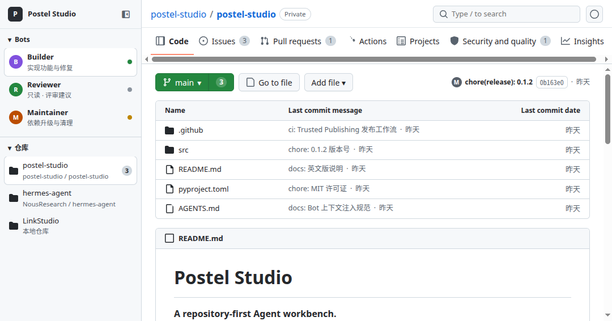

# Postel Studio · 设计文档

> 讨论定稿 v1 · 2026-11-26
>
> 语言：本文档仍是中文（原文即证据，整篇翻译排期见 [`docs/LANGUAGE.md`](../LANGUAGE.md)）；新文档用英文。

| 文档 | 内容 | 对应讨论阶段 |
|---|---|---|
| [01-requirements.md](01-requirements.md) | 定位、已定决定（D1~D15）、权限模型、记忆四层、连接能力、MVP 边界、悬空问题 | 阶段 1 需求 |
| [02-architecture.md](02-architecture.md) | 进程模型、Cordis 风格模块划分、统一 Bot 运行时接口、工作区隔离、接入层、落盘 | 阶段 2 方案 |
| [02b-protocol.md](02b-protocol.md) | 三层协议（前端↔内核 / 内核↔PI）、帧格式、订阅、权限往返、禁止事项 | 阶段 2 通信契约 |
| [03-ui-spec.md](03-ui-spec.md) | 仿 GitHub 的仓库页规格、产品区区分、交互与验收口径 | 阶段 2 UI |
| [04-task-breakdown.md](04-task-breakdown.md) | M1~M3 里程碑、依赖图、21 个垂直切片 | 阶段 3 拆解 |
| [05-security.md](05-security.md) | 威胁模型、认证、权限、输入校验、密钥管理、供应链、隐私、PR 验收清单 | 阶段 2 安全底线 |
| [06-data-model.md](06-data-model.md) | 五个实体、字段与约束、状态机、关系、落盘一致性、迁移 | 阶段 2 数据 |
| [07-api-contract.md](07-api-contract.md) | 方法清单、错误码表、请求/响应、事件、兼容演进 | 阶段 2 接口 |

## 原型

**当前基线：v2**，按真实 GitHub 复刻 7 个一级 tab + Insights 11 子页。

| 版本 | 文件 | 说明 |
|---|---|---|
| **v2（当前）** | [`prototype/postel-studio-proto-v2.html`](prototype/postel-studio-proto-v2.html) | 7 个一级 tab，不含 Agents |
| v1 | [`prototype/postel-studio-proto-v1.html`](prototype/postel-studio-proto-v1.html) | 含变更收件箱与 Agents 页 |
| v0 | [`prototype/v0/postel-studio-proto.html`](prototype/v0/postel-studio-proto.html) | 最初骨架，仅留档 |

直接用浏览器打开即可，无需构建。版本差异与注意事项见 [`prototype/README.md`](prototype/README.md)。
截图见 [`shots/`](shots/)（由浏览器实际渲染后抓取）。

## 事实基线

本文档中所有关于外部产品（GitHub、OpenCode、DSH、Pi、T3）的陈述都经过实际查证：

- GitHub 页面结构：取自真实页面存档与 OpenCLI 打开的真实站点
- OpenCode ACP：本机实装 1.19.6 并完成 `initialize` / `session/new` 握手
- DSH ACP：读安装包 `dsh-acp` / `dsh-acp-app` 的 README 与 `cordis.patch.yml`
- Pi：本机实装 `@earendil-works/pi-coding-agent@1.6.1` 并核对导出面
- T3 连接能力：读其 `docs/internals/adding-a-provider.md` 与 `docs/user/providers-acp.md`

**未经实测的推断在文中已显式标注为「待验证」。**
